# tufte-data-viz

An agent skill that applies [Edward Tufte's](https://www.edwardtufte.com/) data visualization principles when generating charts, plots, and graphs. Produces clean, honest, high-data-ink-ratio visualizations across the main charting libraries for JavaScript, Python and R — extended with modern screen-first standards for accessibility, responsiveness, and interactivity.

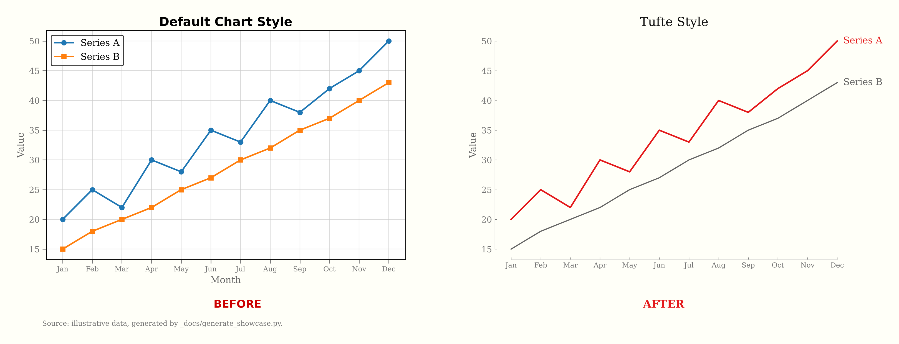

**[Try the live demo](https://mayar-ariss.github.io/tufte-data-viz/)**: toggle between default and Tufte styling across ECharts, Chart.js, Plotly and D3.js, in light and dark mode.

## Install

```bash
npx skills add mayar-ariss/tufte-data-viz
```

Works with any agent the [skills CLI](https://skills.sh) supports, including Claude Code, Cursor, Codex, GitHub Copilot and Gemini CLI. The original version is available with `npx skills add caylent/tufte-data-viz`.

> **About this fork.** An enhanced fork of [caylent/tufte-data-viz](https://github.com/caylent/tufte-data-viz), maintained by [@mayar-ariss](https://github.com/mayar-ariss), with bug fixes, an accessible palette and closer fidelity to Tufte. All credit for the original skill goes to its authors. See [what's different in this fork](#whats-different-in-this-fork).

## Try it

Once installed, ask your agent for a chart the way you normally would. The skill applies itself:

- *"Plot monthly revenue against target from sales.csv with matplotlib."*
- *"Build a Recharts bar chart of signups by channel, sorted."*
- *"Review this ECharts config and remove the chartjunk."*
- *"Make a dark-mode version of this Plotly dashboard."*
- *"Draw a flowchart of our order process in Mermaid."*

## Fair warning

This skill is **opinionated by design**. It will remove your gridlines, delete your legends, reject your pie charts, and insist on serif fonts. It enforces a specific visual philosophy — Tufte's — not a neutral one. If you want total creative freedom over your chart styling, this is not the skill for you. If you want every chart to come out clean, honest, and readable without thinking about it, read on.

## Examples

<table>
  <tr>
    <td width="50%">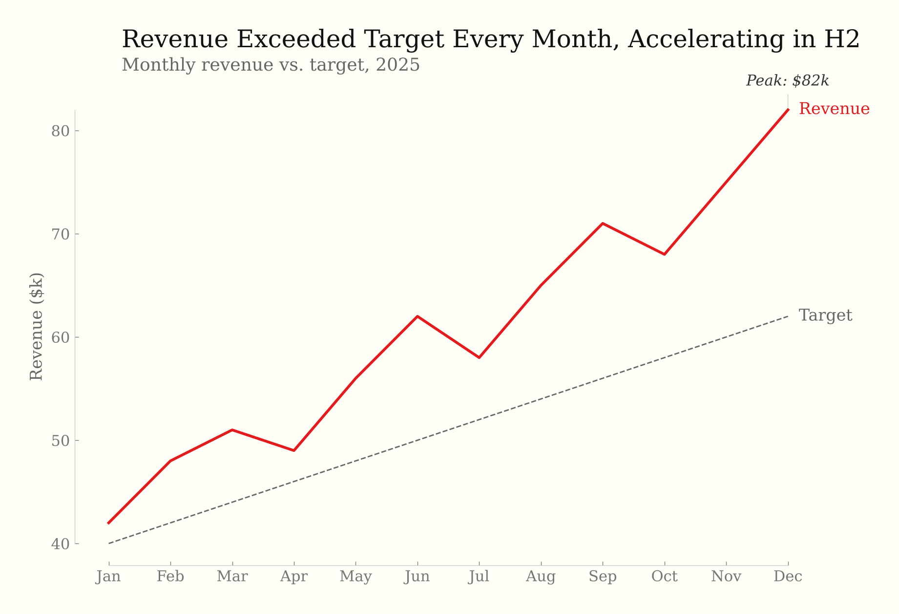<br><b>Line chart</b> — direct labels, range-frame axes, annotation</td>
    <td width="50%">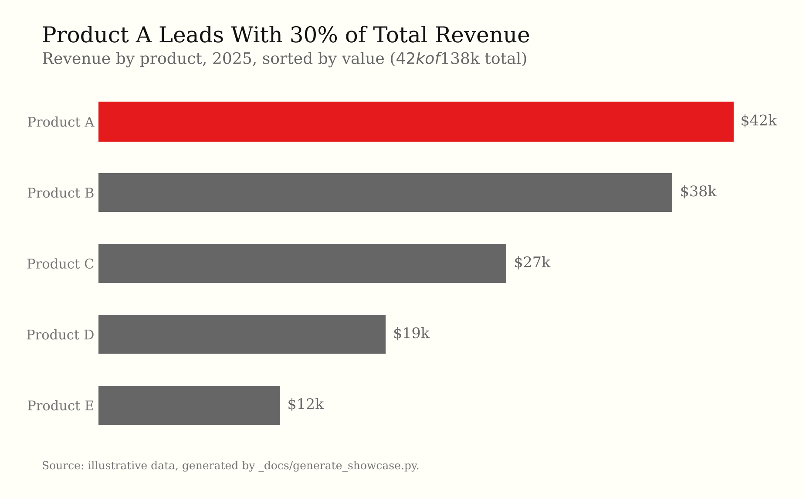<br><b>Bar chart</b> — sorted by value, leader highlighted</td>
  </tr>
  <tr>
    <td>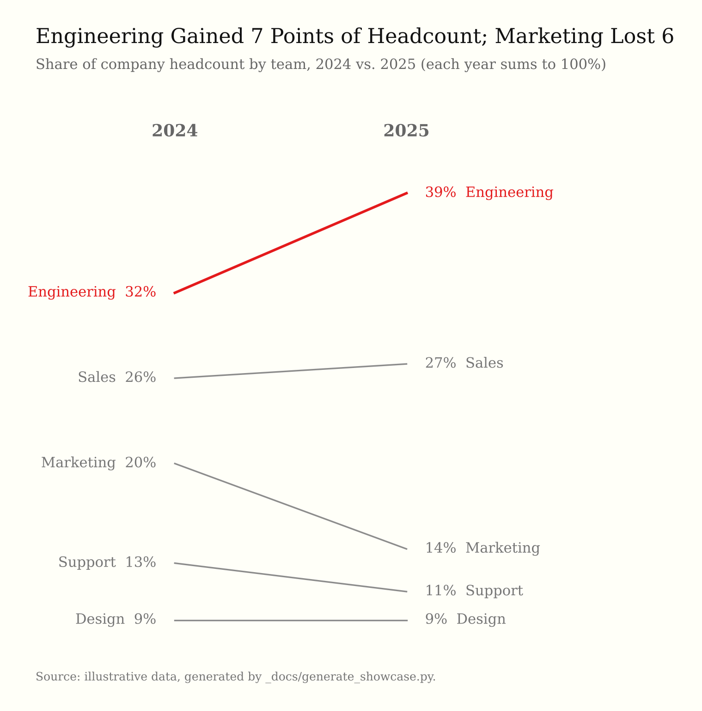<br><b>Slopegraph</b> — before/after comparison</td>
    <td>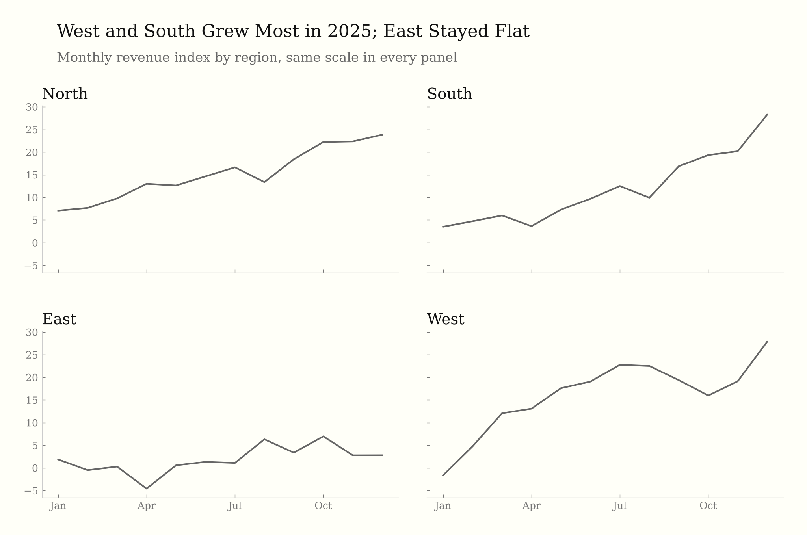<br><b>Small multiples</b> — shared scale, minimal chrome</td>
  </tr>
  <tr>
    <td>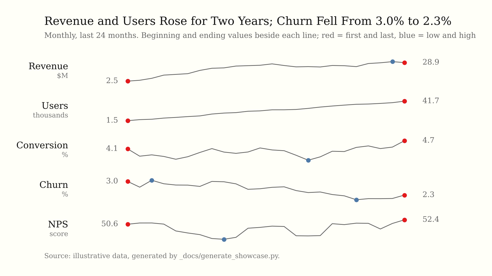<br><b>Sparklines</b> — with beginning and ending values, Tufte's red first/last and blue low/high marks</td>
    <td>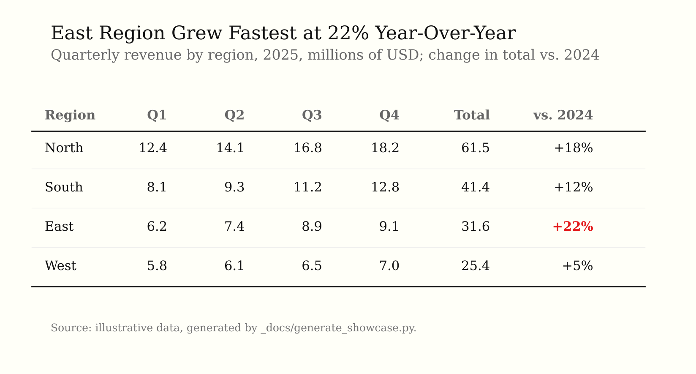<br><b>Data table</b> — whitespace, thin rules, outlier highlighted</td>
  </tr>
  <tr>
    <td>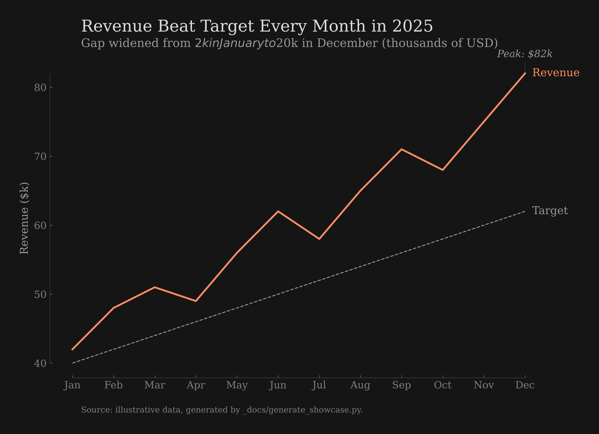<br><b>Dark mode</b> — designed palette, not inverted</td>
    <td>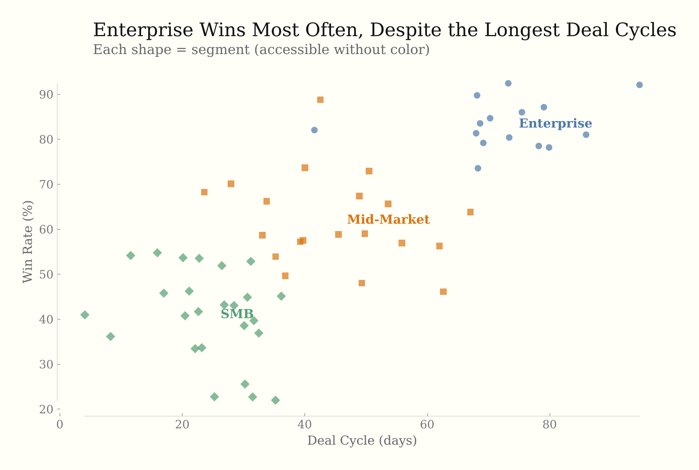<br><b>Accessible scatter</b> — shape + color, readable without color</td>
  </tr>
</table>

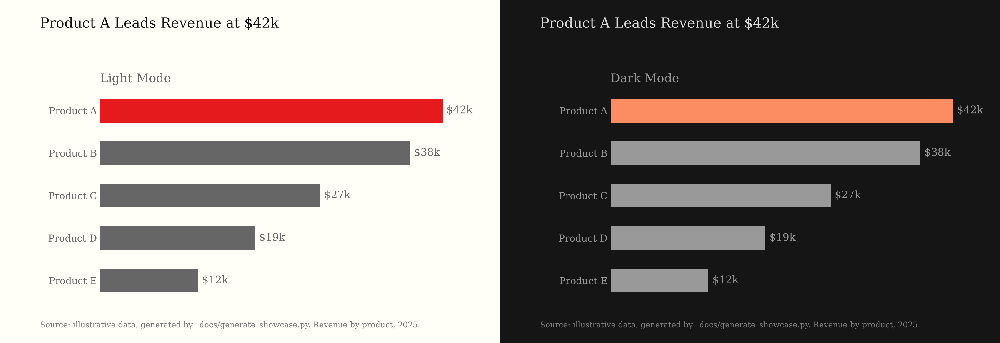<br>
<b>Light & dark</b> — the same chart in both themes

### Accessible palette

Every text and data color meets the skill's own contrast rule: 4.5:1 for text, 3:1 for data marks. `scripts/check_contrast.py` checks the documented palette so it can't drift.

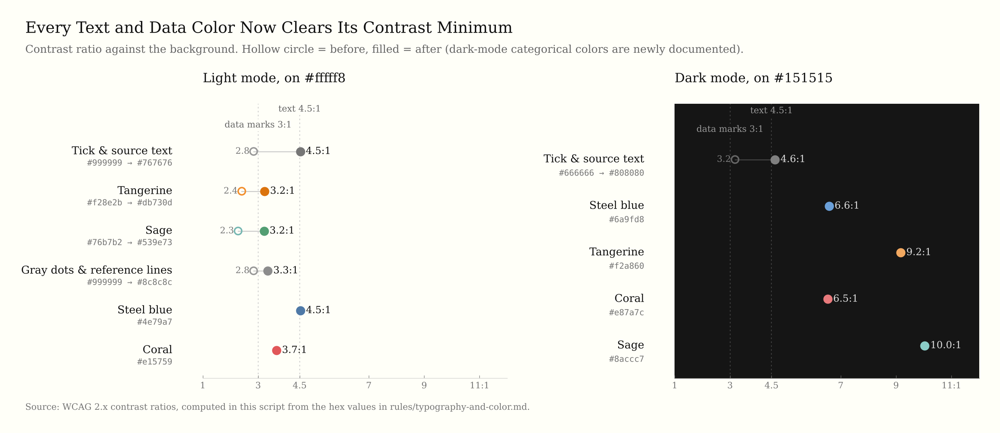

### See it in motion

Gridlines fade, legends become direct labels, chartjunk dissolves:

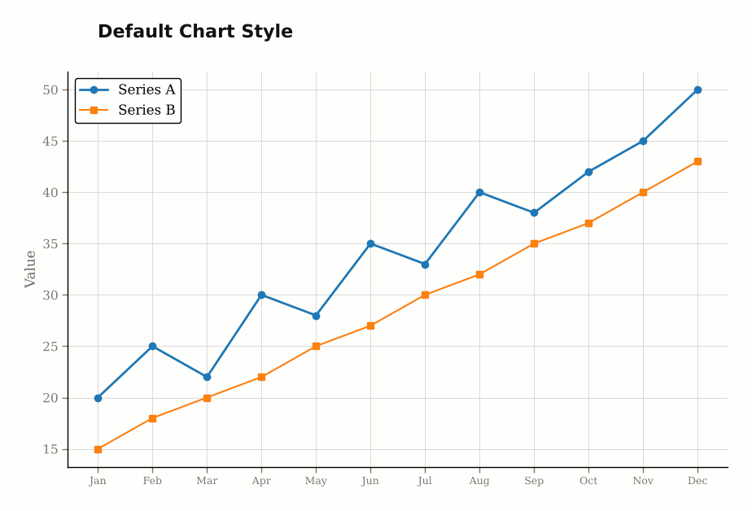

The [live demo](https://mayar-ariss.github.io/tufte-data-viz/) shows these transitions in each library. ([Caylent's original demo](https://caylent.github.io/tufte-data-viz/) uses the earlier palette.)

## What it does

Every rule names its source: **Tufte** (cited by book and chapter), **convention** (common Tufte-style practice he did not state), or **extension** (added by this skill's authors). Tufte's principles are never mixed with the skill's own choices.

**Graphical integrity** — Tufte's six principles from *The Visual Display of Quantitative Information*, checked before anything else:

- Proportional representation (the lie factor), clear labeling, data variation rather than design variation
- Deflated units for money over time, no more dimensions than the data has, no data out of context

**Data-ink** — Tufte's five data-ink principles ("within reason"), his three forms of chartjunk (moiré vibration, dark grids, the duck), and what he asks for beyond erasing: data density, multifunctioning elements, micro/macro readings.

**Analytical design** — the six principles of *Beautiful Evidence* ch. 5, including documentation: every chart states its source and units.

Then 22 universal rules in three tiers, plus guidance on chart types and diagrams:

<details>
<summary>Show the rules</summary>

**Static principles (rules 1–14)** — mostly Tufte's data-ink principles, with a few conventions labeled as such:

- Maximize data-ink ratio — remove gridlines, borders, legends, and decoration that don't convey data
- Direct labeling, range-frame axes, no 3D, no pie charts (unless forced), no dual y-axes
- Serif type in upper-and-lower case with words spelled out (Tufte's friendly data graphic), gray as primary color with selective highlighting, off-white backgrounds (a convention)
- Annotate notable features, show comparison context, minimal tooltips

**Screen-first principles (rules 15–19)** — extensions for modern interactive contexts. Where one pulls against Tufte (progressive disclosure vs. his data density), the rule says so:

- Progressive disclosure (overview first, details on hover/tap/click)
- WCAG accessibility (contrast ratios, dual encoding, keyboard nav, screen reader text alternatives)
- Responsive design (fluid/adaptive strategies, touch targets, mobile-adapted chart types)
- Purposeful animation (data transitions only, respect `prefers-reduced-motion`)
- Intentional dark mode (semantic color tokens, never invert, reduce saturation)

**Content & formatting (rules 20–22)** — extensions, except rule 22, which is Tufte's:

- Titles assert findings ("Revenue Surged 23%"), not axis descriptions
- Numbers formatted for humans ($1.2M, thousand separators, matched precision)
- Don't chart what a sentence or table can say better (Tufte: a sentence is poor for more than two numbers; tables suit many small data sets)

**Chart types** — Tufte's own designs where he made one: sparklines with end values, normal-range band and banking to 45°, slopegraphs, the quartile plot and the dot-dash plot.

**Flowcharts and diagrams** — guidance drawn only from Tufte: connectors that state their meaning (*Beautiful Evidence* ch. 3), type instead of boxes, layering and separation (*Envisioning Information* ch. 3), and the smallest effective difference (*Visual Explanations* ch. 4). Where Tufte gives no rule (shapes, swimlanes, layout direction), none is added. Includes Mermaid and Graphviz notes.

</details>

## Supported libraries

| Library | Rule file | Language |
|---------|-----------|----------|
| [Recharts](https://recharts.org/) | `rules/recharts.md` | React/JSX |
| [ECharts](https://echarts.apache.org/) | `rules/echarts.md` | JavaScript |
| [Chart.js](https://www.chartjs.org/) | `rules/chartjs.md` | JavaScript |
| [matplotlib](https://matplotlib.org/) (and seaborn) | `rules/matplotlib.md` | Python |
| [Plotly](https://plotly.com/) | `rules/plotly.md` | Python/JS |
| [ggplot2](https://ggplot2.tidyverse.org/) and [plotnine](https://plotnine.org/) | `rules/ggplot2-plotnine.md` | R / Python |
| [Vega-Lite](https://vega.github.io/vega-lite/) and [Altair](https://altair-viz.github.io/) | `rules/vega-lite-altair.md` | JSON / Python |
| [Observable Plot](https://observablehq.com/plot/) | `rules/observable-plot.md` | JavaScript |
| D3.js / SVG / HTML | `rules/svg-html.md` | Web |

## How it's organized

| Path | What it holds |
|------|---------------|
| `SKILL.md` | The 22 rules, chart-type guidance, color tokens and a validation checklist. The agent always reads this. |
| `rules/<library>.md` | Full configuration and complete examples for one library, with the version it was written for. The agent reads only the one it needs. |
| `rules/interactive-and-accessible.md` | Progressive disclosure, accessibility, responsive layout, animation, dark mode |
| `rules/typography-and-color.md` | Font stacks, palettes and hex values; the source of truth for colors |
| `rules/anti-patterns.md` | Common violations, per-library detection patterns and one-line fixes |
| `rules/small-multiples-sparklines.md` | Small multiples, sparklines, slopegraphs, rug plots |
| `rules/diagrams-flowcharts.md` | Flowcharts, process maps, org charts and networks, drawn only from Tufte's writing on connectors, layering and explanation |
| `examples/` | Runnable reference implementations for Recharts, ECharts, Chart.js, matplotlib, Plotly and SVG |
| `scripts/check_contrast.py` | Checks the documented palette against the contrast minimums |
| `_docs/` | Showcase figures and the script that generates them |

## What's different in this fork

The improvements are being offered back upstream ([PR #1](https://github.com/caylent/tufte-data-viz/pull/1), [issue #2](https://github.com/caylent/tufte-data-viz/issues/2)).

- **Bug fixes:** Chart.js elements no longer render invisible, sparkline examples are no longer upside down, deprecated ECharts options are replaced, and broken seaborn and Recharts snippets are fixed.
- **Accessible palette:** every text and data color now meets the skill's own contrast rule (4.5:1 text, 3:1 data), with a dark-mode categorical palette and a checker script (`scripts/check_contrast.py`).
- **Accessibility and motion in every library guide:** text alternatives and no load-in animation by default, so charts follow rules 16 and 18 out of the box.
- **Titles that state the finding** in every example (rule 20), plus a few accuracy corrections.
- **Showcase figures regenerated** with the new palette; three figure titles that contradicted their own data are corrected.
- **Faithful to Tufte:** every rule names its source (Tufte, convention or extension), his six graphical integrity principles are added, and misattributed rules and misquotations are corrected.

## Contributing

Issues and pull requests are welcome. Before opening a PR:

- **Changed a color?** Update `rules/typography-and-color.md`, then run `python3 scripts/check_contrast.py`. It exits non-zero if any text or data color misses its minimum.
- **Changed the showcase figures?** Run `python3 _docs/generate_showcase.py` to regenerate every image in `_docs/`.
- **Changed a chart title?** Check it against the data. Rule 20 asks titles to state the finding, so a title that misstates the data is a bug.

## Based on

- *The Visual Display of Quantitative Information* (1983)
- *Envisioning Information* (1990)
- *Visual Explanations* (1997)
- *Beautiful Evidence* (2006)

## License

MIT. Original work © 2026 Caylent; see [LICENSE](LICENSE). Fork changes are released under the same license.
