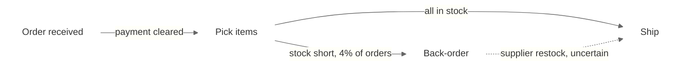
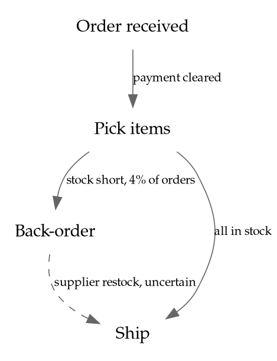

# Diagrams and Flowcharts

Load this file for flowcharts, process maps, organization charts, network diagrams and other box-and-arrow diagrams.

These draw on different parts of Tufte's work than statistical charts do. *Visual Explanations* (VE) is about "pictures of verbs": mechanism, process, cause and effect. *Envisioning Information* (EI) covers layering and separation, and micro/macro reading. *Beautiful Evidence* (BE), ch. 3, "Links and Causal Arrows: Ambiguity in Action", is about connectors; its list of practices for analytical diagrams (pp. 78–79) is followed by rules 1–3 and 10–12 below. Every rule below is Tufte's and names its source. Where Tufte gives no rule, this file says so instead of supplying one.

**What carries over from SKILL.md:** data-ink and chartjunk (no 3D, shadows or gradients on shapes; VDQI ch. 4–5); direct labels instead of legends (rule 2: the meaning of a link style goes on the link; a key only if the styles are too many to label in place, unframed); muted color with strong color only in small areas (rule 8); and type (rule 10: upper-and-lower case, words spelled out, running horizontally; serif by default). Diagram tools often default to all-caps, abbreviated or rotated labels; the rule still applies.

**What does not apply:** the rules about axes, baselines, range frames, aspect ratio and the lie factor as a ratio of plotted effects. Those concern quantities plotted against scales. Where a diagram does carry a quantity, rule 13 applies.

## Rules

### 1. Make every connector say what it means

*Source: Tufte, BE ch. 3 (p. 79, "Annotated linking lines"); edwardtufte.com, "Design of causal diagrams: Barr art chart, Lombardi diagrams, evolutionary trees, Feynman diagrams, timelines" (2003).*

Tufte's central criticism of diagrams: the nouns are specific and detailed while the links are "soft, simple, dichotomous (either there is an arrow or there is not)", so an arrow is a verb that never says which verb it is. His remedy is that each arrow be accompanied by one or two verbs describing the character of the relationship (2003), and that "identical links should be used only if identical processes operate everywhere" (BE p. 79). He praises the Feynman diagrams for "the labels on the linking lines" (2003), and his measure for the whole drawing is cartographic: analytical diagrams should be "clear, efficient, undecorated, maplike" (BE p. 79).

- Label each connector with what it stands for: the action, cause, condition, sequence or quantity.
- Draw links that mean different things differently; draw links that mean the same thing the same way.

### 2. Treat links as evidence

*Source: Tufte, BE ch. 3 (p. 79, "Credibility" and "Alternative diagrams"; closing sentence); edwardtufte.com, "Links, Causal Arrows, Networks" (2004) and "Design of causal diagrams" (2003).*

In Tufte's treatment "the links themselves are taken as explanatory evidence" (2004), and a linking line or arrow of implied causality is easy to draw but hard to support (2003). "An analytical graphic should provide reasons to believe" (BE p. 79): each connector is a claim about the subject, and the diagram should carry the detail that lets a reader judge it. Asked how to evaluate an influence diagram, he answers "by the usual standards for evidence of causality" and offers Bradford Hill's paper on causal inference as "a good start" (2003); the chapter closes by asking readers to take causal diagrams and linking lines seriously, like real evidence (p. 79). Draw the links the evidence supports, and consider the competing diagram: "alternative diagrams test the credibility of the favored diagram" (p. 79).

### 3. Let type carry the structure, not boxes

*Source: Tufte, BE ch. 3 (p. 79, margin note); edwardtufte.com, "Links, Causal Arrows, Networks" (2004) and "Design of causal diagrams" (2003).*

"Omitting boxes increases explanatory resolution" (BE p. 79). Tufte holds up an organization chart whose typographic design "replaces the conventional design of bureaucrats-in-boxes" (2004), and notes in the Feynman diagrams "the lack of node boxes and circles" (2003). Use words and their arrangement to show structure, and drop enclosures that add no information. *This file's application of VDQI ch. 4:* an enclosure that does carry information (a boundary of responsibility, a system edge) is data-ink; keep it, label it, and draw it in the muted layer of rule 4.

### 4. Layer and separate; avoid 1 + 1 = 3

*Source: Tufte, EI ch. 3, "Layering and Separation" (p. 61).*

Two strong lines placed side by side create a third, unintended element: the space between them. Heavy box outlines and dense connector lines produce exactly this noise. Mute the supporting layer (outlines, guides, backgrounds) so the content layer reads first. Separate layers by differences in value, weight and color, not by adding more lines.

### 5. Use the smallest effective difference

*Source: Tufte, VE ch. 4, "The Smallest Effective Difference" (p. 73).*

"Make all visual distinctions as subtle as possible, but still clear and effective." Distinctions between line types, weights and colors are as small as will still read; small contrasts leave room for more distinctions in one diagram.

### 6. Show mechanism and cause

*Source: Tufte, VE (introduction: "pictures of verbs"); BE ch. 3 (p. 78, "Focus on causality"); BE ch. 5, "The Fundamental Principles of Analytical Design" (second principle: show causality, mechanism, explanation, systematic structure).*

A process diagram should explain how one step produces the next, not only show that the steps are connected. Rules 1, 7 and 10–12 are how that explanation gets onto the page.

### 7. Put words, numbers and images together

*Source: Tufte, BE ch. 4, "Words, Numbers, Images — Together"; BE ch. 1 (mapped pictures: labels belong on the image); VDQI ch. 9 (pp. 180–181).*

Place the explanation of an element beside that element on the diagram, so the reader is not sent to a legend or to a paragraph elsewhere to decode it. What belongs below the diagram is its documentation (rule 15) and notes that would crowd the drawing; Tufte's own pages carry sources and asides in the margin, next to the image they concern, not on a separate page.

### 8. Fix clutter by design, not by removing content; design for two readings

*Source: Tufte, EI ch. 2, "Micro/Macro Readings" (pp. 37–51).*

"Confusion and clutter are failures of design, not attributes of information" (EI p. 51), and "to clarify, add detail" (p. 37). A complicated process does not justify a cluttered diagram, and it does not justify cutting the content either. Apply rules 3–5 to the design.

A large diagram should read at two distances, as Tufte's micro/macro designs do: the whole pattern at a glance and the individual detail up close, with the detail supplying the context for the whole (EI ch. 2). Give the structure (stages, groupings, main path) its own weight and position so it survives at arm's length; keep the individual links and annotations in the lighter layer (rule 4).

### 9. Ask what the diagram teaches

*Source: Tufte, comment on "Links, Causal Arrows, Networks", edwardtufte.com (2006).*

Tufte's test for network and linking images: what did you learn, beyond seeing an elegant architecture? A diagram that only shows that things are connected has not yet explained anything.

### 10. Say how certain each link is, and when and how it operates

*Source: Tufte, BE ch. 3 (pp. 78–79, "Focus on causality" and "Annotated linking lines"; the SARS transmission diagram).*

A label is the least a link should carry. "Links and arrows should provide specifics: when and how the link operates, its strength and persistence, credibility of evidence for the link" (BE p. 79). Tufte's exemplar is the SARS transmission diagram, which "distinguishes between more and less certain links" (p. 79): "uncertainties in causal links can sometimes be shown graphically; the SARS diagram indicates uncertain transmission routes with dotted arrows" (p. 78).

- A hypothesized or uncertain link is drawn differently from an established one (dotted against solid, as in the SARS diagram) and says so in its label.
- Where the link operates only under a condition or at a time, the condition or time is on the link.
- Where the strength is known (a rate, a count, a probability), the number is on the link.

### 11. Links left out are claims too

*Source: Tufte, edwardtufte.com, "Design of causal diagrams" (2003); BE ch. 3 (p. 79, "Alternative diagrams").*

Of the Barr art chart Tufte writes that the same evidential issues "arise from the absence of arrows between certain nouns as well" (2003): a missing link asserts that no relationship exists. Check the omissions with the same care as the links drawn, and test the diagram against the alternative in which the link is present (p. 79). Where the evidence is missing rather than negative, that is one of the "relevant issues" Tufte's documentation principle asks the graphic to point out (BE p. 133; rule 15), so the gap does not read as a finding.

### 12. Annotate the nouns, and carry more than one level of data

*Source: Tufte, BE ch. 3 (pp. 78–79, "Annotated nouns" and "Multiple sources and levels of data").*

"Like linking lines and causal arrows, nouns in diagrams should be labeled, annotated, explained, described" (BE p. 79). In the SARS diagram each node is a particular patient with a virus-strain identifier, a place and a journey, and the one drawing presents evidence from molecular isolates, clinical observations, epidemiological fieldwork and public-health statistics (p. 78). A box that says only "Review" or "Approval" is an unannotated noun.

- A node carries its particulars: what it is, who does it or where it happens, when, how many or how long.
- A diagram may carry several levels of evidence at once (the step, its owner, its measured duration, its source); the levels are separated by rule 4, not left out.

### 13. When a flow has a quantity, its width is the quantity

*Source: Tufte, VDQI ch. 1 (pp. 40–41, Minard) and ch. 2 (first integrity principle); BE ch. 5 (pp. 126–127); edwardtufte.com, "Links, Causal Arrows, Networks", Tufte's comment of October 2006 on flow diagrams; `rules/maps.md` rule 19.*

Minard's flow lines carry the size of the army in their width (BE p. 126), and Tufte holds even Minard to the measure: the two widths at the Niemen "were inaccurately constructed in a ratio of 1 to 28" (p. 127). The first integrity principle is that a quantity physically measured on the graphic is directly proportional to the number it represents (VDQI ch. 2). When flow diagrams came up on his forum, Tufte's one contribution was to point readers to a comparison of poor and better flow-diagram designs (2006); he wrote no rule of his own beyond Minard.

- A flow that stands for a quantity (volume, count, money, time) has a width proportional to it, on a linear scale, with the number labeled on the flow.
- A connector that stands for no quantity has a uniform thin line; thickness that encodes nothing is non-data-ink (VDQI ch. 4).

### 14. Compare: alternatives and before-and-after as parallel multiples

*Source: Tufte, BE ch. 5 (first principle: show comparisons, contrasts, differences); BE ch. 3 (p. 79, "Alternative diagrams"); EI ch. 4, "Small Multiples" (p. 67); VE ch. 5, "Parallelism: Repetition and Change, Comparison and Surprise" (pp. 79–103).*

The first principle of analytical design is comparison, and "at the heart of quantitative reasoning is a single question: Compared to what?" (EI p. 67). For a process, the comparison is the current against the proposed, or the competing designs of the same system, and Tufte wants the alternatives drawn, since they test the credibility of the favored diagram (BE p. 79). Small multiples put them in one eyespan with a constant design (EI ch. 4). VE's chapter on parallelism inventories the devices that let the eye compare: pairing, orientation, simultaneity, overlap, superimposition, codes, pointer lines, sequence, adjacency, analogy (VE ch. 5).

- Draw the alternatives on the same layout, at the same size and orientation, side by side, so the differences in the diagrams are differences in the process.
- Elements of the same kind look the same and sit the same way (parallelism); the reader should not have to ask whether a difference in drawing is a difference in meaning (rules 1 and 5).

### 15. Document the diagram on the diagram

*Source: Tufte, BE ch. 5 (fifth principle, p. 133); BE ch. 3 (p. 79: links "credible, documented, explained, quantified"); `rules/maps.md` rule 18.*

Tufte's fifth principle of analytical design is documentation: provide a detailed title, indicate the authors and sponsors, document the data sources, show complete measurement scales, point out relevant issues (BE p. 133). A diagram is a presentation of evidence like any other, and his questions for a causal diagram include whether its links are "documented" (p. 79).

- On the diagram: a title naming the process or system and its scope; who drew it; the date or version; the source of the description (the document, data or people it came from); the scale of any quantity shown (rule 13); known gaps or open questions, stated.

## Where Tufte gives no rule

Tufte prescribes no flowchart notation. He gives no rules on standard shapes (decision diamonds, terminators), layout direction, swimlanes, numbering, or how to route crossing lines, and this skill adds none. His one general measure is the map: "designs for analytical diagrams should be clear, efficient, undecorated, maplike" (BE p. 79). Use the notation the user asks for, and apply the rules above to it.

## Implementation notes

These are tool syntax, not principles.

**Mermaid**

- `-->|label|` puts the meaning on each connector (rule 1); a rate or count in the label states the strength (rule 10).
- `-.->` draws an uncertain link dotted, as the SARS diagram does (rule 10).
- `classDef plain fill:none,stroke:none;` removes the boxes so type carries the structure (rule 3).
- `linkStyle` mutes the connectors (rule 4).
- `edgeLabelBackground` set to the page color stops Mermaid drawing a filled box behind each connector label (rule 3).
- Mermaid cannot scale a link's width from data; for a flow with quantities (rule 13) use Graphviz `penwidth` or a Sankey renderer.

**Graphviz (DOT)**

- `shape=plaintext` drops the boxes (rule 3).
- `label=` on each edge states its meaning (rule 1); `style=dashed` marks an uncertain link (rule 10).
- For a quantity-bearing flow, set `penwidth` per edge from the data on one linear scale (rule 13).

Colors and fonts come from `rules/typography-and-color.md`.

## Validation checklist

- [ ] Every connector's meaning is stated on the diagram; links that mean different things look different, links that mean the same thing look the same (BE ch. 3)
- [ ] Every link drawn is supported by the evidence, and the omitted links were checked too (BE ch. 3; Tufte, 2003)
- [ ] Uncertain links are drawn and labeled as uncertain; conditions, timing and known strengths are on the links (BE p. 79)
- [ ] Nodes carry their particulars, not generic step names (BE p. 79)
- [ ] No box or outline that carries no information (BE ch. 3)
- [ ] Supporting lines are muted; no heavy parallel lines creating 1 + 1 = 3 (EI ch. 3)
- [ ] Explanations sit on the diagram, next to what they explain (BE ch. 4)
- [ ] A flow that stands for a quantity has a width proportional to it, labeled with the number (VDQI ch. 2; BE ch. 5)
- [ ] Alternatives or before-and-after are drawn as parallel multiples on one layout (BE ch. 5; EI ch. 4; VE ch. 5)
- [ ] Title, author, date or version, source and scale are on the diagram (BE ch. 5)
- [ ] A large diagram reads at a distance and up close (EI ch. 2)
- [ ] The diagram explains a mechanism or relationship, not only that things connect (VE; Tufte's test)
