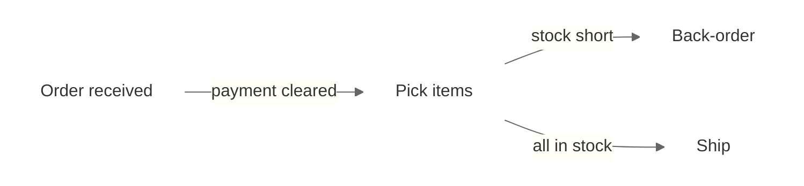
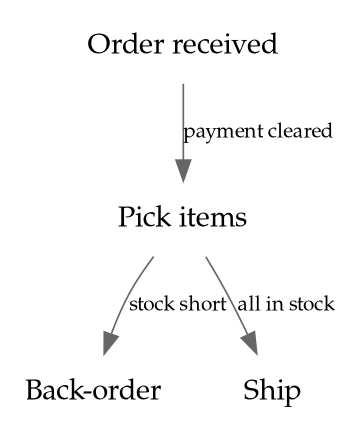

# Diagrams and Flowcharts

Load this file for flowcharts, process maps, organization charts, network diagrams and other box-and-arrow diagrams.

These draw on different parts of Tufte's work than statistical charts do. *Visual Explanations* (VE) is about "pictures of verbs": mechanism, process, cause and effect. *Envisioning Information* (EI) covers layering and separation. *Beautiful Evidence* (BE), ch. 3, "Links and Causal Arrows: Ambiguity in Action", is about connectors. Every rule below is Tufte's and names its source. Where Tufte gives no rule, this file says so instead of supplying one.

**What carries over from SKILL.md:** data-ink and chartjunk (no 3D, shadows or gradients on shapes; VDQI ch. 4–5), direct labels instead of legends (rule 2), and muted color with strong color only in small areas (rule 8).

**What does not apply:** the rules about axes, baselines, range frames, aspect ratio and the lie factor. Those concern quantities plotted against scales.

## Rules

### 1. Make every connector say what it means

*Source: Tufte, BE ch. 3.*

Tufte's central criticism of diagrams: connecting lines and arrows are often drawn identically even when they mean different things (a cause, a sequence, a flow, a vague "related to"), so their meaning is ambiguous. He asks that connectors become "more articulate, more differentiated, less generic."

- Label each connector with what it stands for: the action, cause, condition or quantity.
- Draw links that mean different things differently.

### 2. Treat links as evidence

*Source: Tufte, BE ch. 3 (draft on edwardtufte.com, "Links, Causal Arrows, Networks").*

In Tufte's treatment, a link is itself explanatory evidence, and its credibility can be assessed like any other evidence. Each connector is a claim about the subject. Draw the links the evidence supports.

### 3. Let type carry the structure, not boxes

*Source: Tufte, BE ch. 3 (same draft).*

Tufte holds up an organization chart that replaces the conventional people-in-boxes design with typography. Use words and their arrangement to show structure, and drop enclosures that add no information.

### 4. Layer and separate; avoid 1 + 1 = 3

*Source: Tufte, EI ch. 3, "Layering and Separation".*

Two strong lines placed side by side create a third, unintended element: the space between them. Heavy box outlines and dense connector lines produce exactly this noise. Mute the supporting layer (outlines, guides, backgrounds) so the content layer reads first. Separate layers by differences in value, weight and color, not by adding more lines.

### 5. Use the smallest effective difference

*Source: Tufte, VE ch. 4, "The Smallest Effective Difference".*

Make distinctions between line types, weights and colors as small as will still read clearly.

### 6. Show mechanism and cause

*Source: Tufte, VE (introduction: "pictures of verbs"); BE ch. 5, "The Fundamental Principles of Analytical Design" (show causality, mechanism, explanation, systematic structure).*

A process diagram should explain how one step produces the next, not only show that the steps are connected. Rules 1 and 7 are how that explanation gets onto the page.

### 7. Put words, numbers and images together

*Source: Tufte, BE ch. 4, "Words, Numbers, Images — Together"; VDQI ch. 9.*

Place explanations on the diagram, next to the elements they explain, rather than in a separate legend or caption.

### 8. Fix clutter by design, not by removing content

*Source: Tufte, EI ("Confusion and clutter are failures of design, not attributes of information").*

A complicated process does not justify a cluttered diagram, and it does not justify cutting the content either. Apply rules 3–5 to the design.

### 9. Ask what the diagram teaches

*Source: Tufte, comment on "Links, Causal Arrows, Networks", edwardtufte.com (2006).*

Tufte's test for network and linking images: what did you learn, beyond seeing an elegant architecture? A diagram that only shows that things are connected has not yet explained anything.

## Where Tufte gives no rule

Tufte prescribes no flowchart notation. He gives no rules on standard shapes (decision diamonds, terminators), layout direction, swimlanes, numbering, or how to route crossing lines, and this skill adds none. Use the notation the user asks for, and apply the rules above to it.

## Implementation notes

These are tool syntax, not principles.

**Mermaid**

- `-->|label|` puts the meaning on each connector (rule 1).
- `classDef plain fill:none,stroke:none;` removes the boxes so type carries the structure (rule 3).
- `linkStyle` mutes the connectors (rule 4).
- `edgeLabelBackground` set to the page color stops Mermaid drawing a filled box behind each connector label (rule 3).

**Graphviz (DOT)**

- `shape=plaintext` drops the boxes (rule 3).
- `label=` on each edge states its meaning (rule 1).

Colors and fonts come from `rules/typography-and-color.md`.

## Validation checklist

- [ ] Every connector's meaning is stated on the diagram; links that mean different things look different (BE ch. 3)
- [ ] Every link drawn is supported by the evidence (BE ch. 3)
- [ ] No box or outline that carries no information (BE ch. 3)
- [ ] Supporting lines are muted; no heavy parallel lines creating 1 + 1 = 3 (EI ch. 3)
- [ ] Explanations sit on the diagram, next to what they explain (BE ch. 4)
- [ ] The diagram explains a mechanism or relationship, not only that things connect (VE; Tufte's test)
